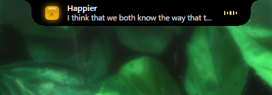
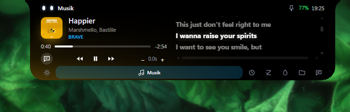
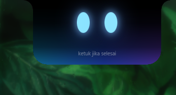
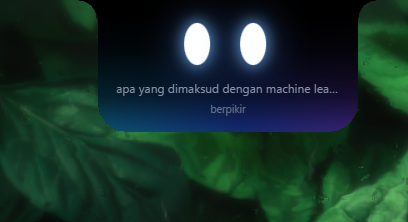
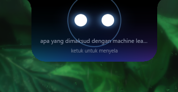
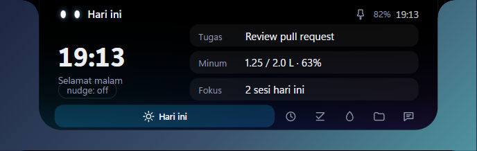
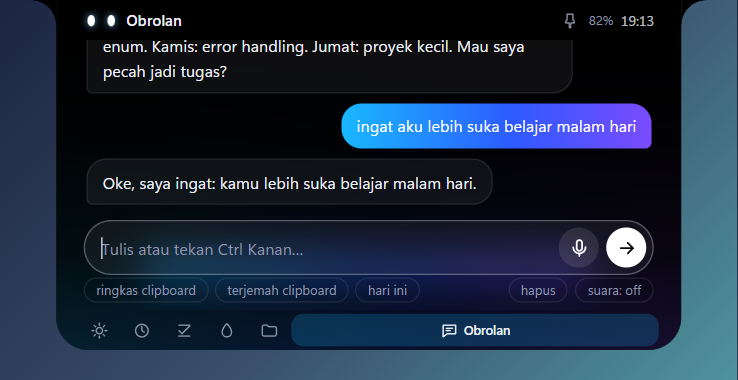
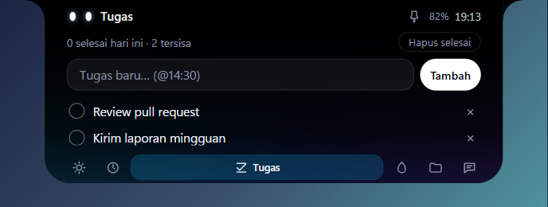
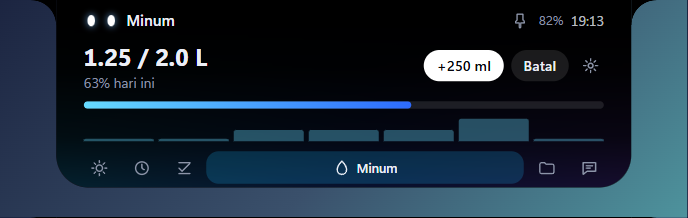

# Blip

[English](README.md)

Asisten AI berbentuk *dynamic island* untuk Windows. Arahkan kursor ke notch: panel membuka halaman Hari ini, Musik, Fokus, Tugas, Minum, Shelf, dan Obrolan (dot + panah, scroll wheel). Tekan tombol Copilot: island mendengar, menjawab dengan teks + suara, lalu mengecil. Saat mouse keluar, panel menutup kecuali sedang mengetik atau AI menjawab.

Host native Rust: QuickJS menjalankan JavaScript UI asli, taffy menghitung layout DOM/CSS, dan Direct2D/DirectWrite menggambar layered window Win32. Tanpa proses WebView2 atau Electron. Lisensi MIT.

<p align="center">
  
</p>
<p align="center">
  
</p>
<p align="center">
  
  
  
</p>
<p align="center">
  
  
  
  
</p>

## Instal

1. Unduh `Blip_0.3.2_x64-setup.exe` dari halaman [Releases](https://github.com/caidenniw/blip-notch/releases) (per-user, tanpa admin, ada uninstaller).
2. Installer belum ditandatangani: SmartScreen menampilkan peringatan, klik "More info" -> "Run anyway".
3. Jalankan Blip sekali. Aplikasi membuat `%APPDATA%\Blip\blip.config.json`.
4. Buka Pengaturan (ikon gear di header notch atau tray), isi endpoint, API key dan model di bagian AI, lalu Hubungkan. Konfigurasi disimpan hanya setelah model utama berhasil menjawab.

## Setup

Blip bicara ke endpoint apa pun yang kompatibel dengan OpenAI (`/chat/completions`, streaming). Cukup ubah tiga hal di `router`:

| Kunci | Arti |
|---|---|
| `baseUrl` | alamat API, tanpa `/chat/completions` |
| `apiKey` | kunci API (kosong untuk server lokal) |
| `models` | daftar model id; dicoba berurutan, model berikutnya dipakai bila yang sebelumnya gagal |
| `headers` | opsional: header HTTP tambahan untuk tiap permintaan |

Contoh (cek penyedia untuk model id terbaru):

| Penyedia | `baseUrl` | `apiKey` | contoh model |
|---|---|---|---|
| OpenAI | `https://api.openai.com/v1` | `sk-...` | `gpt-4o-mini` |
| OpenRouter | `https://openrouter.ai/api/v1` | `sk-or-...` | `openai/gpt-4o-mini` |
| Groq | `https://api.groq.com/openai/v1` | `gsk_...` | `llama-3.3-70b-versatile` |
| Ollama (lokal) | `http://127.0.0.1:11434/v1` | kosong | model yang sudah di-pull, mis. `llama3.2` |

Perubahan config butuh restart app. Path config bisa diganti lewat env `BLIP_CONFIG`.

## Suara (opsional)

Obrolan teks jalan tanpa bagian ini.

- STT: isi `stt.apiKey` dengan kunci Groq, atau pasang `uv` + `ffmpeg` (whisper lokal via `uv run --with faster-whisper`).
- TTS: pasang `uv` lalu `uv tool install edge-tts`; pilih suara di `tts.voice` (mis. `id-ID-GadisNeural` perempuan, `id-ID-ArdiNeural` laki-laki). Atau isi `tts.provider: "elevenlabs"` dengan `elevenApiKey`, `elevenVoiceId`, `elevenModel`; bila ElevenLabs gagal, Blip jatuh ke edge-tts.

## Config

`%APPDATA%\Blip\blip.config.json`. Bentuk bawaan ada di [`blip.config.example.json`](blip.config.example.json):

```json
{
  "router": { "baseUrl": "https://api.openai.com/v1", "apiKey": "", "models": ["gpt-4o-mini"], "headers": {} },
  "stt":    { "provider": "groq", "apiKey": "", "model": "whisper-large-v3-turbo", "language": "id" },
  "tts":    { "enabled": true, "voice": "id-ID-ArdiNeural", "provider": "edge", "elevenApiKey": "", "elevenVoiceId": "", "elevenModel": "eleven_multilingual_v2" },
  "ui":     { "port": 51321, "holdMs": 300, "autoCollapseMs": 5000 },
  "systemPrompt": ""
}
```

- `systemPrompt` kosong -> persona bawaan Blip.
- `stt.provider != "groq"` atau `apiKey` kosong -> whisper lokal.

## Perilaku

| Aksi | Hasil |
|---|---|
| Tap tombol Copilot (Right Ctrl) | island mendengar, diam 1.3 dtk -> jawab + suara |
| Tahan >= `ui.holdMs` | dikte: teks ditempel ke app aktif, clipboard dipulihkan |
| Tap saat mendengar | kirim lebih awal |
| Tap saat menjawab | hentikan suara, mendengar lagi |
| Hover notch | buka panel halaman relevan (musik berjalan -> Musik, timer fokus -> Fokus, selain itu halaman terakhir); histeresis 18px/6px |
| Drag file dekat notch | zona magnet 520px bangunkan notch ke Shelf |
| Keluar hover | mengecil setelah 300 ms; tetap terbuka bila disematkan (pin), input berisi teks, sedang drag, atau AI menjawab |
| Tombol Pin | sematkan notch agar tetap terbuka |
| `‹` `›`, dot, wheel | pindah halaman dengan transisi geser halus |
| Musik | cover, judul, artis, badge player (Spotify/Brave/dll), seek bar, lirik otomatis split view (LRCLIB), klik baris = seek |
| Fokus | Pomodoro 25/5/15 dengan chips cepat, ring progres, sesi 1-4 |
| Tugas | to-do lokal + jam pengingat (`@14:30`), klik dua kali teks untuk edit, centang/hapus |
| Minum | target harian, `+250 ml`, grafik per 2 jam, pengingat saat jam aktif |
| Shelf | tarik file masuk/keluar, tombol Salin (`FileDropList`), Buka Lokasi di Explorer, Tempel (Ctrl+V) |
| Hari ini | jam besar, tugas berikutnya, progres minum, sesi fokus; klik baris = lompat ke halaman itu; tombol `nudge: on/off` |
| Obrolan | riwayat tersimpan (40 pesan, tombol `hapus`); chip `ringkas clipboard`, `terjemah clipboard`, `hari ini` (clipboard dibaca hanya saat chip diklik) |
| Nudge | island menyapa sendiri (sapaan, tugas sore, larut malam, baterai <= 20%), maks 1 per 10 mnt, hanya saat idle, tanpa suara |
| Ingatan | `ingat <fakta>`, `apa yang kamu ingat`, `lupakan semua` (tersimpan lokal, disuntik ke system prompt) |
| Hover (default) | buka halaman Hari ini bila panel terakhir dibuka > 30 mnt lalu |
| HUD | volume, Caps Lock, charger/baterai, bahasa keyboard, status internet, perangkat audio |
| Idle | mata kecil netral, jam HH:mm 24 jam menetap, ikon dan persentase baterai bila tersedia; charging diprioritaskan, baterai rendah merah hanya tanpa charging; mata hanya berkedip sesekali dan mengikuti reduced motion |
| Full-screen | notch otomatis bersembunyi saat aplikasi atau game layar penuh berjalan |
| `Ctrl+Alt+B` (bisa diganti di Pengaturan → Umum) | sama dengan tap tombol Copilot |
| `Ctrl+Alt+Q` | keluar |

Tray: Buka/Tutup, Mulai saat login, Pengaturan…, Keluar.

Jendela Pengaturan (600×540, ikon gear di header): endpoint/API key/model AI dengan tes model langsung, suara masuk dan keluar, perilaku notch, halaman yang tampil, target fokus dan air, autostart, hotkey, tombol dikte, gerakan dan kecepatan animasi. Pilihan hotkey: Ctrl+Alt+B, Ctrl+Alt+Space, Ctrl+Shift+Space; `Ctrl+Alt+Q` tetap. Perubahan `blip.config.json` langsung berlaku; preferensi island (hover, jeda tutup, halaman tersembunyi, nudge, angka fokus/air) disimpan di `localstorage.json`.

Versi 0.3.3 menambahkan compact berbasis overlap: jendela aplikasi terlihat yang beririsan dengan area normal idle/live membuat Blip mengecil menjadi garis tipis, termasuk jendela tidak aktif. Jendela minimized/cloaked, shell desktop, dan overlay layered pasif (termasuk kursor Cua dan NVIDIA) diabaikan. Hover tepi atas untuk membuka; geser jendela menjauh agar ukuran normal kembali. Aplikasi fullscreen tetap menyembunyikan Blip sepenuhnya. Area deteksi tidak ikut menyusut sehingga compact tidak berkedip. Perubahan bentuk memakai pegas teredam dengan sudut dan telinga tersinkron; jalur renderer meminjam teks/style tanpa menyalinnya. Gunakan executable release teroptimasi untuk sehari-hari.

Versi 0.3.2 mempertahankan status idle dalam satu baris: mata kecil netral, jam HH:mm 24 jam menetap, serta ikon dan persentase baterai dibulatkan bila tersedia. Charging diprioritaskan termasuk pada 0%; baterai tanpa charging pada 20% atau kurang berwarna merah; baterai tidak tersedia menyembunyikan grupnya. Pill tetap 192×32 dan compact sliver tidak berubah. Mata hanya berkedip sesekali tanpa glow, mengikuti kursor, mood acak atau transisi tidur. Musik dan lirik tidak berubah. Ikon **Awake b** dan kontrol pengingat Tugas dari 0.3.1 tetap dipertahankan; upgrade menjaga konfigurasi dan data tugas.

Batasan yang diketahui: rilis tampilan idle ini tidak memperbaiki batasan keamanan existing. API kontrol loopback belum mengautentikasi pemanggil; dikte dapat menempelkan teks ke aplikasi foreground saat hasil selesai; recovery storage rusak dan penyimpanan Pengaturan bersamaan masih perlu diperkuat. Hindari dikte sensitif dan jangan membuka port kontrol ke host lain.

Versi 0.3.0 menambahkan pergantian bahasa Inggris/Indonesia langsung, pemeriksaan model AI utama dan cadangan, serta menu Umum, AI, Suara, Notch, Halaman, Fokus & Air. Sakelar halaman langsung berlaku termasuk baris Hari ini. Klik native yang sebelumnya memanggil handler dua kali dan membatalkan perubahan sakelar sudah diperbaiki.

Tugas: tulis tugas, opsional pilih **Ingatkan** → **15 menit lagi**, **1 jam lagi**, atau **Pilih tanggal & jam**, lalu Tambah. Waktu pengingat tampil jelas dan bisa dihapus tanpa menghapus draf. Tanggal tidak valid dan waktu lewat ditolak; teks tugas tidak memerlukan sintaks pengingat.

Perintah lokal (suara atau teks, tanpa LLM, maks 7 kata): `lagu berikutnya`/`skip`, `lagu sebelumnya`, `pause`, `lanjutkan musik`, `volume naik|turun|mute` (`banget` = 20%), `volume 50` (0-100), `buka spotify|youtube|youtube music|whatsapp|gmail|github|chatgpt`, `putar <judul> di youtube|spotify`, `timer 5 menit`, `minum`, `mulai fokus`/`stop fokus`, `tambah tugas <teks> [@14:30]`.

Catatan: tombol Copilot di laptop pengembang terpetakan ke Right Ctrl (VK 0xA3). Semua Right Ctrl diperlakukan sama.

## Server kontrol

`127.0.0.1:51321` (hanya loopback):

| Rute | Efek |
|---|---|
| `GET /health` | `{"ok":true}` |
| `POST /toggle` | tap hotkey |
| `POST /show` | buka + mendengar |
| `POST /hide` | tutup |
| `POST /ask` `{"text":"..."}` | tanya tanpa mic |
| `POST /agent` `{"agent":"claude","state":"working|waiting|done","text":"..."}` | notifikasi island |

Contoh hook Claude Code (`~/.claude/settings.json`):

```json
{
  "hooks": {
    "UserPromptSubmit": [{ "hooks": [{ "type": "command", "command": "curl -s -X POST http://127.0.0.1:51321/agent -d \"{\\\"agent\\\":\\\"claude\\\",\\\"state\\\":\\\"working\\\"}\"" }] }],
    "Notification": [{ "hooks": [{ "type": "command", "command": "curl -s -X POST http://127.0.0.1:51321/agent -d \"{\\\"agent\\\":\\\"claude\\\",\\\"state\\\":\\\"waiting\\\"}\"" }] }],
    "Stop": [{ "hooks": [{ "type": "command", "command": "curl -s -X POST http://127.0.0.1:51321/agent -d \"{\\\"agent\\\":\\\"claude\\\",\\\"state\\\":\\\"done\\\"}\"" }] }]
  }
}
```

## Build dari source

Prasyarat:

- Windows 10/11 (tidak memerlukan WebView2)
- Rust: `winget install Rustlang.Rustup`, lalu `rustup default stable-x86_64-pc-windows-msvc`
- Visual Studio 2022 Build Tools + C++ workload:
  `winget install Microsoft.VisualStudio.2022.BuildTools --override "--quiet --wait --add Microsoft.VisualStudio.Workload.VCTools --includeRecommended"`
- Node.js dan Microsoft Edge hanya untuk harness screenshot pembanding

```powershell
cargo run
cargo test
cargo build --release    # target\release\blip.exe
powershell -File tools\ref\run.ps1
```

Harness membandingkan 16 snapshot native dengan headless Edge pada 640×460; setiap skenario harus di bawah 1,5% piksel berbeda. Executable menyertakan `ui/index.html`, `ui/style.css`, `ui/lib.js`, dan `ui/app.js` asli, bukan terjemahan UI manual ke Rust.

Probe renderer isolated (Windows/Direct2D): `cargo test --release engine::tests::native_hot_paths_benchmark -- --ignored --exact --nocapture --test-threads=1`. Gunakan `CARGO_TARGET_DIR=target/refactor-build`, `APPDATA` sandbox kosong, dan `BLIP_CONFIG` di sandbox tersebut. Test tidak menjalankan `main`, mutex instance, window, tray, atau services; storage hanya memori. Dua workload layout Unicode/control dan paint filter/pseudo memakai warmup 100, lalu 5×1000 iterasi; output `case`, `batch`, `iterations`, `elapsed_ms`, `ns_per_iter`. Bandingkan executable baseline/candidate tersimpan pada profile dan mesin sama. Angka ini bukan CPU idle atau RAM aplikasi terpasang.


Penyimpanan UI memakai `%APPDATA%\Blip\localstorage.json`, terpisah dari `blip.config.json`. `state.json` dari port native sebelumnya dibiarkan dan tidak dimigrasi. Batas yang diketahui: tanpa panah spinner input angka, scrollbar tipis pada jawaban, dan seleksi teks terbatas satu bubble.

Frame animasi mengikuti refresh rate monitor (60/120/144 Hz) lewat `DwmFlush`; saat tidak ada animasi, timer Win32 waitable beresolusi tinggi hanya bangun untuk timer JS, caret, dan penyimpanan, sehingga CPU idle mendekati nol. Cascade CSS yang tidak berubah memakai cache antarframe animasi, dan animasi yang hanya mengubah tampilan tidak menghitung ulang layout. Semua build bisa mencatat durasi update/present per frame ke `%APPDATA%\Blip\blip.log` melalui `BLIP_PROFILE_FRAMES=1`; hasilnya diagnostik, bukan jaminan FPS.

Perubahan bentuk island (ukuran, radius sudut, telinga) memakai pegas teredam, ditulis `spring(<bounce>)` di `ui/style.css`. Easing ini khusus mesin CSS native Blip: durasi transisi adalah response pegas, bukan seluruh waktu sampai berhenti. Membuka memakai response 0,42 dtk dengan bounce 0,2, menutup 0,45 dtk teredam kritis. Pegas yang dipotong mempertahankan kecepatan untuk nilai skalar dan pembalikan langsung, dengan batas pengaman bila target terlalu dekat. Parameter terinspirasi aplikasi notch macOS, bukan replika persis gerakan proprietary Apple. Nilai kelancaran dari build release; biaya frame debug jauh lebih tinggi pada probe lokal 144 Hz, bukan jaminan FPS tampilan end-to-end.

## Privasi

- Teks obrolan dikirim ke endpoint yang kamu atur di `router.baseUrl`.
- Audio mic dikirim ke Groq hanya bila `stt.apiKey` diisi; selain itu diproses lokal.
- Teks yang dibacakan dikirim ke Microsoft Edge TTS atau ElevenLabs (bila dipakai).
- Clipboard dibaca hanya saat chip clipboard diklik.
- Config, termasuk kunci API, tersimpan sebagai JSON biasa di `%APPDATA%\Blip`.
- Server kontrol hanya mendengarkan loopback.

## Struktur

```
ui/                index.html, style.css, app.js (state machine island), lib.js (fungsi pure), app.test.js (`npm test`)
src-tauri/src/     main.rs, conf.rs, island.rs, keys.rs, rec.rs, ai.rs, media.rs (GSMTC + lirik), sys.rs (HUD audio/baterai, shelf), server.rs
scripts/stt_local.py
```

## Lisensi

[MIT](LICENSE)
