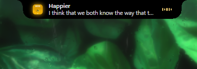
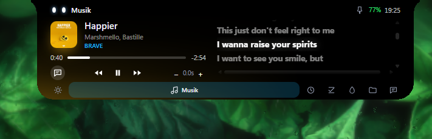
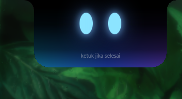
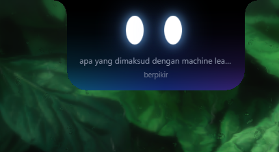
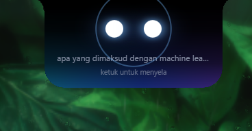
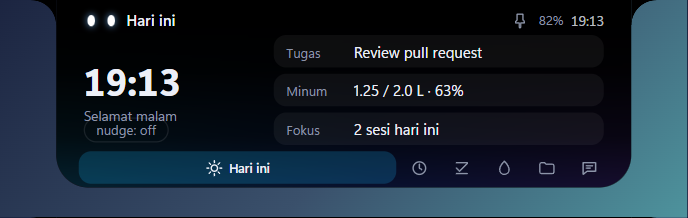
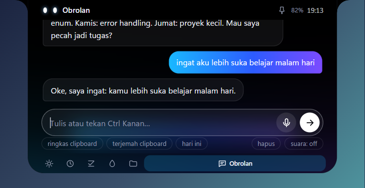
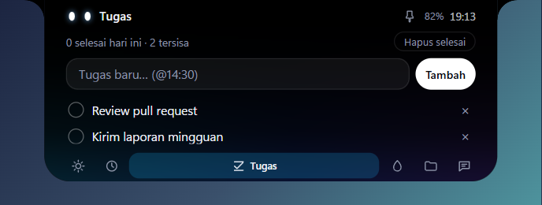
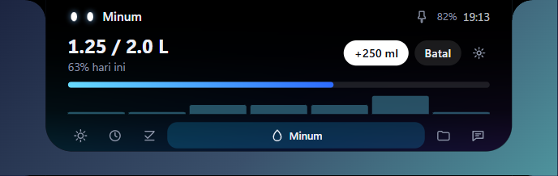

# Blip

[English](README.md)

Asisten AI berbentuk *dynamic island* untuk Windows. Arahkan kursor ke notch: panel membuka halaman Hari ini, Musik, Fokus, Tugas, Minum, Shelf, dan Obrolan (dot + panah, scroll wheel). Tekan tombol Copilot: island mendengar, menjawab dengan teks + suara, lalu mengecil. Saat mouse keluar, panel menutup kecuali sedang mengetik atau AI menjawab.

Dibangun dengan Tauri 2 (Rust + WebView2) — bukan Electron. Lisensi MIT.

<p align="center">
  
</p>
<p align="center">
  
</p>
<p align="center">
  
  
  
</p>
<p align="center">
  
  
  
  
</p>

## Instal

1. Unduh `Blip_0.1.0_x64-setup.exe` dari halaman [Releases](https://github.com/caidenniw/blip-notch/releases) (per-user, tanpa admin, ada uninstaller).
2. Installer belum ditandatangani: SmartScreen menampilkan peringatan, klik "More info" -> "Run anyway".
3. Jalankan Blip sekali. Aplikasi membuat `%APPDATA%\Blip\blip.config.json`.
4. Klik ikon tray -> "Buka config", isi `router.apiKey` (lihat Setup), simpan, lalu restart Blip.

## Setup

Blip bicara ke endpoint apa pun yang kompatibel dengan OpenAI (`/chat/completions`, streaming). Cukup ubah tiga hal di `router`:

| Kunci | Arti |
|---|---|
| `baseUrl` | alamat API, tanpa `/chat/completions` |
| `apiKey` | kunci API (kosong untuk server lokal) |
| `models` | daftar model id; dicoba berurutan, model berikutnya dipakai bila yang sebelumnya gagal |
| `headers` | opsional: header HTTP tambahan untuk tiap permintaan |

Contoh (cek penyedia untuk model id terbaru):

| Penyedia | `baseUrl` | `apiKey` | contoh model |
|---|---|---|---|
| OpenAI | `https://api.openai.com/v1` | `sk-...` | `gpt-4o-mini` |
| OpenRouter | `https://openrouter.ai/api/v1` | `sk-or-...` | `openai/gpt-4o-mini` |
| Groq | `https://api.groq.com/openai/v1` | `gsk_...` | `llama-3.3-70b-versatile` |
| Ollama (lokal) | `http://127.0.0.1:11434/v1` | kosong | model yang sudah di-pull, mis. `llama3.2` |

Perubahan config butuh restart app. Path config bisa diganti lewat env `BLIP_CONFIG`.

## Suara (opsional)

Obrolan teks jalan tanpa bagian ini.

- STT: isi `stt.apiKey` dengan kunci Groq, atau pasang `uv` + `ffmpeg` (whisper lokal via `uv run --with faster-whisper`).
- TTS: pasang `uv` lalu `uv tool install edge-tts`; pilih suara di `tts.voice` (mis. `id-ID-GadisNeural` perempuan, `id-ID-ArdiNeural` laki-laki). Atau isi `tts.provider: "elevenlabs"` dengan `elevenApiKey`, `elevenVoiceId`, `elevenModel`; bila ElevenLabs gagal, Blip jatuh ke edge-tts.

## Config

`%APPDATA%\Blip\blip.config.json`. Bentuk bawaan ada di [`blip.config.example.json`](blip.config.example.json):

```json
{
  "router": { "baseUrl": "https://api.openai.com/v1", "apiKey": "", "models": ["gpt-4o-mini"], "headers": {} },
  "stt":    { "provider": "groq", "apiKey": "", "model": "whisper-large-v3-turbo", "language": "id" },
  "tts":    { "enabled": true, "voice": "id-ID-ArdiNeural", "provider": "edge", "elevenApiKey": "", "elevenVoiceId": "", "elevenModel": "eleven_multilingual_v2" },
  "ui":     { "port": 51321, "holdMs": 300, "autoCollapseMs": 5000 },
  "systemPrompt": ""
}
```

- `systemPrompt` kosong -> persona bawaan Blip.
- `stt.provider != "groq"` atau `apiKey` kosong -> whisper lokal.

## Perilaku

| Aksi | Hasil |
|---|---|
| Tap tombol Copilot (Right Ctrl) | island mendengar, diam 1.3 dtk -> jawab + suara |
| Tahan >= `ui.holdMs` | dikte: teks ditempel ke app aktif, clipboard dipulihkan |
| Tap saat mendengar | kirim lebih awal |
| Tap saat menjawab | hentikan suara, mendengar lagi |
| Hover notch | buka panel halaman relevan (musik berjalan -> Musik, timer fokus -> Fokus, selain itu halaman terakhir); histeresis 18px/6px |
| Drag file dekat notch | zona magnet 520px bangunkan notch ke Shelf |
| Keluar hover | mengecil setelah 300 ms; tetap terbuka bila disematkan (pin), input berisi teks, sedang drag, atau AI menjawab |
| Tombol Pin | sematkan notch agar tetap terbuka |
| `‹` `›`, dot, wheel | pindah halaman dengan transisi geser halus |
| Musik | cover, judul, artis, badge player (Spotify/Brave/dll), seek bar, lirik otomatis split view (LRCLIB), klik baris = seek |
| Fokus | Pomodoro 25/5/15 dengan chips cepat, ring progres, sesi 1-4 |
| Tugas | to-do lokal + jam pengingat (`@14:30`), klik dua kali teks untuk edit, centang/hapus |
| Minum | target harian, `+250 ml`, grafik per 2 jam, pengingat saat jam aktif |
| Shelf | tarik file masuk/keluar, tombol Salin (`FileDropList`), Buka Lokasi di Explorer, Tempel (Ctrl+V) |
| Hari ini | jam besar, tugas berikutnya, progres minum, sesi fokus; klik baris = lompat ke halaman itu; tombol `nudge: on/off` |
| Obrolan | riwayat tersimpan (40 pesan, tombol `hapus`); chip `ringkas clipboard`, `terjemah clipboard`, `hari ini` (clipboard dibaca hanya saat chip diklik) |
| Nudge | island menyapa sendiri (sapaan, tugas sore, larut malam, baterai <= 20%), maks 1 per 10 mnt, hanya saat idle, tanpa suara |
| Ingatan | `ingat <fakta>`, `apa yang kamu ingat`, `lupakan semua` (tersimpan lokal, disuntik ke system prompt) |
| Hover (default) | buka halaman Hari ini bila panel terakhir dibuka > 30 mnt lalu |
| HUD | volume, Caps Lock, charger/baterai, bahasa keyboard, status internet, perangkat audio |
| Full-screen | notch otomatis bersembunyi saat aplikasi atau game layar penuh berjalan |
| `Ctrl+Alt+B` | sama dengan tap tombol Copilot |
| `Ctrl+Alt+Q` | keluar |

Tray: Buka/Tutup, Mulai saat login, Buka config, Keluar.

Perintah lokal (suara atau teks, tanpa LLM, maks 7 kata): `lagu berikutnya`/`skip`, `lagu sebelumnya`, `pause`, `lanjutkan musik`, `volume naik|turun|mute` (`banget` = 20%), `volume 50` (0-100), `buka spotify|youtube|youtube music|whatsapp|gmail|github|chatgpt`, `putar <judul> di youtube|spotify`, `timer 5 menit`, `minum`, `mulai fokus`/`stop fokus`, `tambah tugas <teks> [@14:30]`.

Catatan: tombol Copilot di laptop pengembang terpetakan ke Right Ctrl (VK 0xA3). Semua Right Ctrl diperlakukan sama.

## Server kontrol

`127.0.0.1:51321` (hanya loopback):

| Rute | Efek |
|---|---|
| `GET /health` | `{"ok":true}` |
| `POST /toggle` | tap hotkey |
| `POST /show` | buka + mendengar |
| `POST /hide` | tutup |
| `POST /ask` `{"text":"..."}` | tanya tanpa mic |
| `POST /agent` `{"agent":"claude","state":"working|waiting|done","text":"..."}` | notifikasi island |

Contoh hook Claude Code (`~/.claude/settings.json`):

```json
{
  "hooks": {
    "UserPromptSubmit": [{ "hooks": [{ "type": "command", "command": "curl -s -X POST http://127.0.0.1:51321/agent -d \"{\\\"agent\\\":\\\"claude\\\",\\\"state\\\":\\\"working\\\"}\"" }] }],
    "Notification": [{ "hooks": [{ "type": "command", "command": "curl -s -X POST http://127.0.0.1:51321/agent -d \"{\\\"agent\\\":\\\"claude\\\",\\\"state\\\":\\\"waiting\\\"}\"" }] }],
    "Stop": [{ "hooks": [{ "type": "command", "command": "curl -s -X POST http://127.0.0.1:51321/agent -d \"{\\\"agent\\\":\\\"claude\\\",\\\"state\\\":\\\"done\\\"}\"" }] }]
  }
}
```

## Build dari source

Prasyarat:

- Windows 10/11 dengan WebView2 (sudah ada di Windows 11)
- Rust: `winget install Rustlang.Rustup`, lalu `rustup default stable-x86_64-pc-windows-msvc`
- Visual Studio 2022 Build Tools + C++ workload:
  `winget install Microsoft.VisualStudio.2022.BuildTools --override "--quiet --wait --add Microsoft.VisualStudio.Workload.VCTools --includeRecommended"`
- Node.js 18+ (hanya untuk Tauri CLI)

```
npm install
npm run dev      # mode pengembangan
npm test         # tes fungsi UI
npm run build    # installer: src-tauri\target\release\bundle\nsis\Blip_0.1.0_x64-setup.exe
```

Build pertama mengunduh NSIS (butuh internet). Tes Rust: `cargo test --manifest-path src-tauri/Cargo.toml`.

## Privasi

- Teks obrolan dikirim ke endpoint yang kamu atur di `router.baseUrl`.
- Audio mic dikirim ke Groq hanya bila `stt.apiKey` diisi; selain itu diproses lokal.
- Teks yang dibacakan dikirim ke Microsoft Edge TTS atau ElevenLabs (bila dipakai).
- Clipboard dibaca hanya saat chip clipboard diklik.
- Config, termasuk kunci API, tersimpan sebagai JSON biasa di `%APPDATA%\Blip`.
- Server kontrol hanya mendengarkan loopback.

## Struktur

```
ui/                index.html, style.css, app.js (state machine island), lib.js (fungsi pure), app.test.js (`npm test`)
src-tauri/src/     main.rs, conf.rs, island.rs, keys.rs, rec.rs, ai.rs, media.rs (GSMTC + lirik), sys.rs (HUD audio/baterai, shelf), server.rs
scripts/stt_local.py
```

## Lisensi

[MIT](LICENSE)
