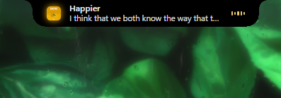
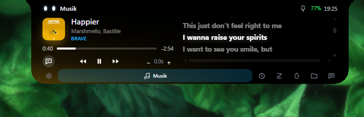
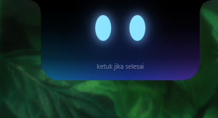
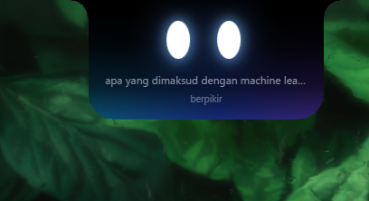
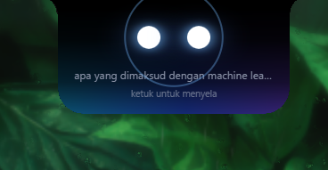
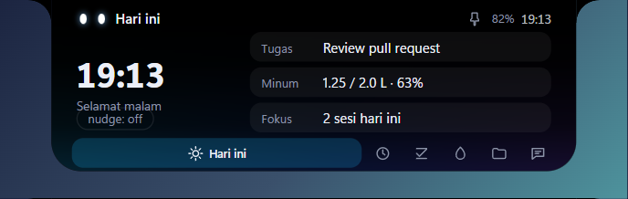
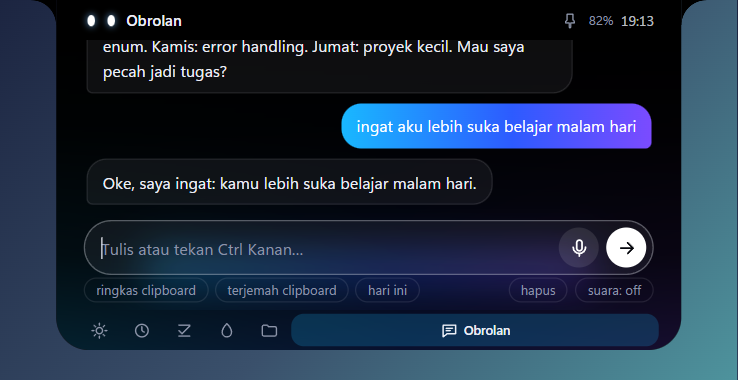
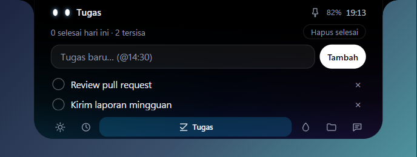
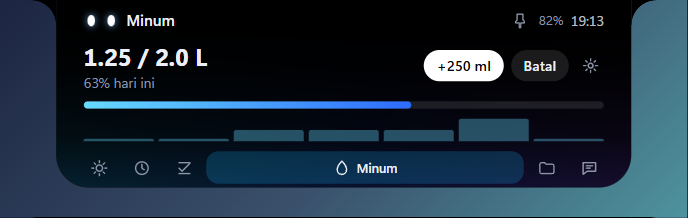

# Blip

[Bahasa Indonesia](README.id.md)

A *dynamic-island* AI assistant for Windows 10/11. Hover the notch and a panel opens with Today, Music, Focus, Tasks, Water, Shelf and Chat pages (dots, arrows, scroll wheel). Press the Copilot key: the island listens, answers with text and voice, then shrinks. When the mouse leaves, the panel closes unless you are typing or the AI is answering.

Native Rust host: QuickJS executes the original UI JavaScript, taffy lays out the DOM/CSS, and Direct2D/DirectWrite paint a layered Win32 window. No WebView2 or Electron process. MIT licensed; UI and default persona are Indonesian.

<p align="center">
  
</p>
<p align="center">
  
</p>
<p align="center">
  
  
  
</p>
<p align="center">
  
  
  
  
</p>

## Features

- Hover panel with pages: Today, Music (cover, seek bar, synced lyrics), Focus (Pomodoro), Tasks (with reminders), Water, Shelf, Chat
- Voice loop: tap the Copilot key (Right Ctrl), speak, get a spoken answer; hold to dictate into the active app
- Chat with saved history and local memory (`ingat <fact>`, `apa yang kamu ingat`, `lupakan semua`)
- Proactive nudges (greeting, afternoon tasks, late night, low battery), at most one per 10 minutes, idle only, silent
- Drag-and-drop file shelf
- System HUD: volume, Caps Lock, charger/battery, keyboard language, connectivity, audio device
- Auto-hides while a full-screen app or game runs

## Install

1. Download `Blip_0.1.0_x64-setup.exe` from [Releases](https://github.com/caidenniw/blip-notch/releases) (per-user install, no admin rights, includes an uninstaller).
2. The installer is unsigned: SmartScreen shows a warning. Click "More info" -> "Run anyway".
3. Run Blip once. It creates `%APPDATA%\Blip\blip.config.json`.
4. Open Settings (gear in the notch header or tray -> "Pengaturan…"), paste the API key under AI, then Test connection.

## Setup

Blip talks to any OpenAI-compatible endpoint (`/chat/completions`, streaming). You only change three things under `router`:

| Key | Meaning |
|---|---|
| `baseUrl` | API address, without `/chat/completions` |
| `apiKey` | API key (leave empty for a local server) |
| `models` | model ids, tried in order; the next one is used when the previous fails |
| `headers` | optional extra HTTP headers sent with every request |

Examples (check the provider for current model ids):

| Provider | `baseUrl` | `apiKey` | example model |
|---|---|---|---|
| OpenAI | `https://api.openai.com/v1` | `sk-...` | `gpt-4o-mini` |
| OpenRouter | `https://openrouter.ai/api/v1` | `sk-or-...` | `openai/gpt-4o-mini` |
| Groq | `https://api.groq.com/openai/v1` | `gsk_...` | `llama-3.3-70b-versatile` |
| Ollama (local) | `http://127.0.0.1:11434/v1` | empty | the model you pulled, e.g. `llama3.2` |

Restart Blip after editing the config. Override the config path with the `BLIP_CONFIG` environment variable.

Default config ([`blip.config.example.json`](blip.config.example.json)):

```json
{
  "router": { "baseUrl": "https://api.openai.com/v1", "apiKey": "", "models": ["gpt-4o-mini"], "headers": {} },
  "stt":    { "provider": "groq", "apiKey": "", "model": "whisper-large-v3-turbo", "language": "id" },
  "tts":    { "enabled": true, "voice": "id-ID-ArdiNeural", "provider": "edge", "elevenApiKey": "", "elevenVoiceId": "", "elevenModel": "eleven_multilingual_v2" },
  "ui":     { "port": 51321, "holdMs": 300, "autoCollapseMs": 5000 },
  "systemPrompt": ""
}
```

An empty `systemPrompt` uses the built-in persona.

## Voice (optional)

Text chat works without any of this.

- STT: set `stt.apiKey` to a Groq key, or install `uv` + `ffmpeg` (local whisper through `uv run --with faster-whisper`).
- TTS: install `uv`, then `uv tool install edge-tts`; pick a voice in `tts.voice` (e.g. `id-ID-GadisNeural` female, `id-ID-ArdiNeural` male). Or set `tts.provider` to `"elevenlabs"` with `elevenApiKey`, `elevenVoiceId`, `elevenModel`; if ElevenLabs fails Blip falls back to edge-tts.

## Usage

| Action | Result |
|---|---|
| Tap Copilot key (Right Ctrl) | island listens, 1.3 s of silence -> answer + voice |
| Hold >= `ui.holdMs` | dictation: text is pasted into the active app, clipboard restored |
| Tap while listening | send early |
| Tap while answering | stop speech, listen again |
| Hover notch | opens the relevant page (music playing -> Music, focus timer -> Focus, otherwise last page) |
| Drag a file near the notch | magnet zone wakes the notch to Shelf |
| Mouse leaves | shrinks after 300 ms; stays open if pinned, input has text, dragging, or AI answering |
| `‹` `›`, dots, wheel | switch pages |
| Chat | history saved (40 messages, `hapus` clears); chips: summarize / translate clipboard, today (clipboard is read only when a chip is clicked) |
| `Ctrl+Alt+B` (configurable in Settings -> Sistem) | same as tapping the Copilot key |
| `Ctrl+Alt+Q` | quit |

Tray: Buka/Tutup (open/close), Mulai saat login (start at login), Pengaturan… (settings), Keluar (quit).

Settings window (600×540, gear icon in the header): AI endpoint/key/models with a live model test, voice input and output, notch behaviour, page visibility, focus and water targets, autostart, hotkey, dictate key, motion and animation speed. Hotkey choices: Ctrl+Alt+B, Ctrl+Alt+Space, Ctrl+Shift+Space; `Ctrl+Alt+Q` stays fixed. Changes to `blip.config.json` apply immediately; island prefs (hover, close delay, hidden pages, nudge, focus/water numbers) live in `localstorage.json`.

Local commands (voice or text, no LLM, up to 7 words; Indonesian): `lagu berikutnya`/`skip`, `lagu sebelumnya`, `pause`, `lanjutkan musik`, `volume naik|turun|mute`, `volume 50`, `buka spotify|youtube|youtube music|whatsapp|gmail|github|chatgpt`, `putar <title> di youtube|spotify`, `timer 5 menit`, `minum`, `mulai fokus`/`stop fokus`, `tambah tugas <text> [@14:30]`.

The Copilot key on the developer's laptop maps to Right Ctrl (VK 0xA3); every Right Ctrl press is treated the same.

## Control server

`127.0.0.1:51321` (loopback only):

| Route | Effect |
|---|---|
| `GET /health` | `{"ok":true}` |
| `POST /toggle` | tap the hotkey |
| `POST /show` | open + listen |
| `POST /hide` | close |
| `POST /ask` `{"text":"..."}` | ask without the mic |
| `POST /agent` `{"agent":"claude","state":"working\|waiting\|done","text":"..."}` | island notification |

Claude Code hook example (`~/.claude/settings.json`):

```json
{
  "hooks": {
    "UserPromptSubmit": [{ "hooks": [{ "type": "command", "command": "curl -s -X POST http://127.0.0.1:51321/agent -d \"{\\\"agent\\\":\\\"claude\\\",\\\"state\\\":\\\"working\\\"}\"" }] }],
    "Notification": [{ "hooks": [{ "type": "command", "command": "curl -s -X POST http://127.0.0.1:51321/agent -d \"{\\\"agent\\\":\\\"claude\\\",\\\"state\\\":\\\"waiting\\\"}\"" }] }],
    "Stop": [{ "hooks": [{ "type": "command", "command": "curl -s -X POST http://127.0.0.1:51321/agent -d \"{\\\"agent\\\":\\\"claude\\\",\\\"state\\\":\\\"done\\\"}\"" }] }]
  }
}
```

## Build from source

Prerequisites:

- Windows 10/11 (WebView2 is not required)
- Rust: `winget install Rustlang.Rustup`, then `rustup default stable-x86_64-pc-windows-msvc`
- Visual Studio 2022 Build Tools with the C++ workload:
  `winget install Microsoft.VisualStudio.2022.BuildTools --override "--quiet --wait --add Microsoft.VisualStudio.Workload.VCTools --includeRecommended"`
- Node.js and Microsoft Edge only for the reference screenshot harness

```powershell
cargo run
cargo test
cargo build --release    # target\release\blip.exe
powershell -File tools\ref\run.ps1
```

The parity harness compares 16 native snapshots with headless Edge at 640×460; each scenario must stay below 1.5% differing pixels. The executable embeds `ui/index.html`, `ui/style.css`, `ui/lib.js`, and `ui/app.js`. These are the original UI sources, not a hand-translated Rust UI.

Browser storage persists in `%APPDATA%\Blip\localstorage.json`, independently of `blip.config.json`. The former native port's `state.json` is left untouched and is not migrated. Known limits: no number-input spinner arrows, thin answer scrollbar, and text selection confined to one bubble.

Animation frames follow the monitor refresh rate (60/120/144 Hz) via `DwmFlush`; when nothing animates, a high-resolution Win32 waitable timer wakes only for JS timers, the caret, and storage flushes, so idle CPU stays near zero. Unchanged CSS cascades are cached between animation frames, and paint-only animations skip layout. Any build can log per-frame update/present durations to `%APPDATA%\Blip\blip.log` with `BLIP_PROFILE_FRAMES=1`; this is diagnostic output, not a frame-rate guarantee.

## Privacy

- Chat text goes to the endpoint you set in `router.baseUrl`.
- Mic audio goes to Groq only if you set `stt.apiKey`; otherwise it is transcribed locally.
- Text to be spoken goes to Microsoft Edge TTS or ElevenLabs, whichever you use.
- The clipboard is read only when you click a clipboard chip.
- The config, including API keys, is plain JSON in `%APPDATA%\Blip`.
- The control server listens on loopback only.

## License

[MIT](LICENSE)
